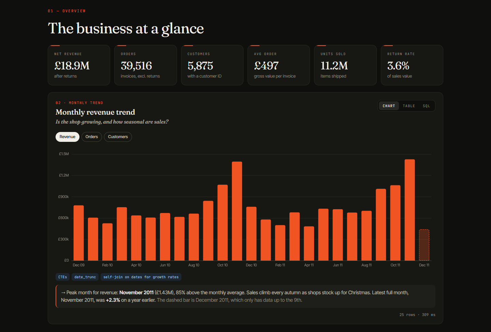
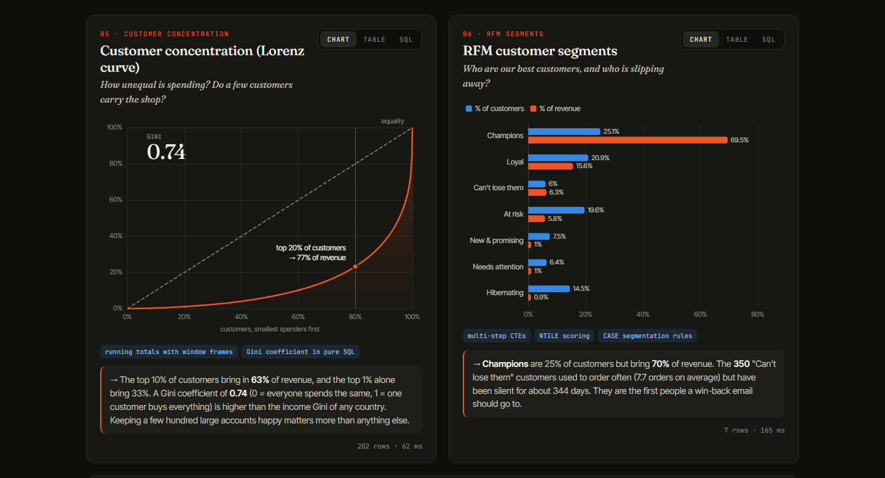
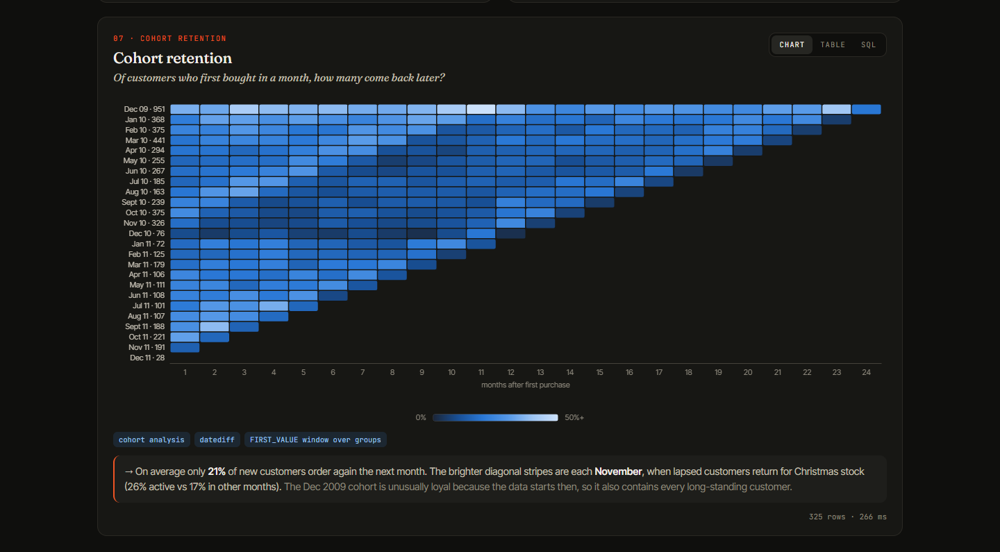

# Retail SQL Analytics

**Ten SQL analyses of one million real online-retail sales lines, run live in your browser.**

### 🔗 [Open the live dashboard](https://z3us-23.github.io/retail-sql-analytics/)



The data is two years of transactions (Dec 2009 – Dec 2011) from a UK online gift wholesaler.
I cleaned it with SQL, then wrote ten SQL queries that each answer one business question.

The dashboard has **no server**. [DuckDB-WASM](https://duckdb.org/docs/api/wasm/overview) runs a
real SQL database inside the browser tab, so:

- every filter (market, period) re-runs all ten queries on the spot, in about 1–3 seconds;
- every chart has a **SQL** tab showing the exact query behind it;
- a **SQL playground** at the bottom lets anyone write their own queries against the data.

The same `.sql` files run in the browser and in a Python test on GitHub Actions, so the code you
read here is exactly the code that drew the charts.

---

## The questions and what the data says

| # | Question | SQL techniques | Finding (full period) |
|---|----------|----------------|------------------------|
| 01 | How big is the business? | `FILTER` clauses, `COUNT DISTINCT` | £18.9M net revenue, 39,516 orders, 5,875 customers, £497 per order |
| 02 | Is it growing, and how seasonal is it? | CTEs, `date_trunc`, self-join on dates | Every autumn builds to a November peak (£1.43M in Nov 2011, +2.3% on Nov 2010) |
| 03 | Which markets matter? | window functions over aggregates, `RANK` | UK = 85% of revenue, but overseas orders are bigger (£853 vs £464) |
| 04 | Which products earn the most? | aggregate first, then join | The cake stand earns most, even though the jumbo bag sells 3.8× more units |
| 05 | How unequal is spending? | running totals, **Gini coefficient in SQL** | Top 20% of customers → 77% of revenue; Gini = 0.74 |
| 06 | Who are the best customers, and who is leaving? | `NTILE` scoring, `CASE` rules (RFM) | "Champions" are 25% of customers but 70% of revenue; 350 big buyers have gone quiet |
| 07 | Do new customers come back? | cohort analysis, `datediff`, `FIRST_VALUE` | Only ~21% re-order the next month; lapsed customers return each November |
| 08 | What is bought together? | self-join, support / confidence / lift | Matching teacups are bought together 21× more often than chance |
| 09 | When do people order? | date parts, heatmap grid | 67% of orders arrive 10:00–15:00; almost none on Saturdays (a B2B business) |
| 10 | What gets returned? | conditional aggregation, thresholds | The worst "return rate" is one 74,215-jar order cancelled 16 minutes later |




---

## Data cleaning

The raw Excel file has 1,067,371 rows. [`etl/clean.sql`](etl/clean.sql) fixes four problems I
found by exploring the data first:

| Step | Rows removed | Why |
|------|-------------:|-----|
| Sheet overlap | 22,523 | The 2009–10 sheet runs to 9 Dec 2010, but the 2010–11 sheet starts on 1 Dec 2010 and repeats those rows exactly |
| Non-product lines | 11,930 | Postage, bank charges, Amazon fees, manual adjustments, test items, zero prices and stock write-offs are not sales of goods |
| Exact duplicates | 11,792 | The same line scanned twice (same invoice, product, quantity, price, time) |
| **Clean sales lines** | **1,021,126** | |

Cancelled orders (invoice numbers starting with `C`) are kept as negative lines so returns can be
analysed. About 22% of lines have no customer ID; they count towards revenue but are left out of
the customer analyses (05–07).

## How it works

```
Excel (UCI) ──► etl/build_data.py ──► etl/clean.sql (DuckDB) ──► data/*.parquet (5.4 MB)
                                                                     │
                     browser:  DuckDB-WASM loads the Parquet ◄───────┘
                               filters rewrite one SQL view: `sales`
                               sql/01–10 run against it ──► ECharts
```

- **Parquet** compresses the million rows to 5.4 MB, small enough to download in a second or two.
- The filters only rewrite one view (`CREATE OR REPLACE VIEW sales AS SELECT … WHERE …`), and
  every query reads from `sales`. Click **Filter SQL** on the dashboard to see it.
- [`etl/run_queries.py`](etl/run_queries.py) runs all ten queries in Python with the same setup.
  [GitHub Actions](.github/workflows/test-sql.yml) runs it on every push, so a broken query fails the build.

## Project structure

```
├── index.html               the dashboard page
├── assets/                  app.js (DuckDB + filters + playground), charts.js, util.js, app.css
├── sql/                     the ten analysis queries (the main work)
├── etl/
│   ├── build_data.py        download → load → clean → export Parquet
│   ├── clean.sql            all cleaning rules, commented
│   └── run_queries.py       runs every query (also the CI test)
└── data/                    sales.parquet, products.parquet, cleaning_report.json
```

## Run it yourself

```bash
git clone https://github.com/Z3US-23/retail-sql-analytics.git
cd retail-sql-analytics
python -m venv .venv
.venv\Scripts\activate            # Windows  (macOS/Linux: source .venv/bin/activate)
pip install -r requirements.txt

python etl/run_queries.py         # run all ten queries in the terminal
python -m http.server 8000        # then open http://localhost:8000
```

To rebuild the data from the original Excel file: `python etl/build_data.py` (downloads 45 MB).

## Limitations

- The data ends on 9 Dec 2011, so December 2011 is a partial month (shown dashed in the trend chart).
- The December 2009 cohort includes every customer who already existed when the data starts, so it
  looks more loyal than later cohorts.
- RFM thresholds are quintiles of this data set, not business-defined targets.
- Market-basket results are limited to the 150 most-ordered products to keep the self-join fast in the browser.

## Data & credits

Chen, D. (2012). *Online Retail II* [Data set]. UCI Machine Learning Repository.
https://doi.org/10.24432/C5CG6D, licensed [CC BY 4.0](https://creativecommons.org/licenses/by/4.0/).
Prices are in GBP.

Built by **Ahmad Ammar**, BS Economics, Forman Christian College, Lahore ·
[Portfolio](https://z3us-23.github.io/Ahmad-Ammar.github.io/) ·
Tools: SQL (DuckDB), Python, JavaScript, Apache ECharts.
